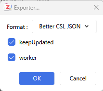
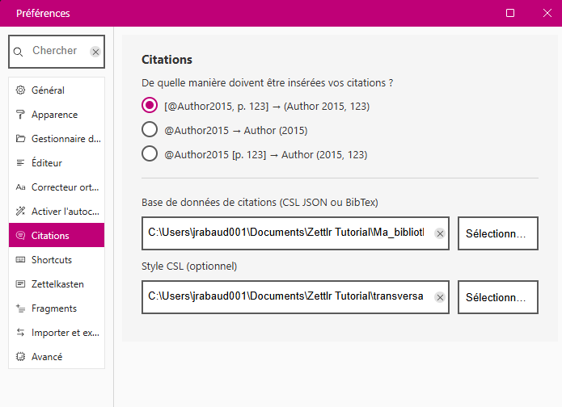

*18h00–19h45 · La BUlle (BU), campus de Pau (UPPA) · entrée libre, sans inscription*

## À installer avant la séance

- [Zettlr](https://www.zettlr.com)
- [Zotero](https://www.zotero.org)
  - l'extension [BetterBibtex](https://retorque.re/zotero-better-bibtex/) pour Zotero.

## Ressources

### Dans *Zotero*

Installer le plugin [Better BibTeX for Zotero](https://retorque.re/zotero-better-bibtex/index.html)

Faire un export de sa collection de projet ou de l'ensemble de sa bibliothèque au format _Better CSL JSON_ en cochant l'option `garder à jour` (_keepUpdated_).

 

Enregistrer le fichier `.json` dans le dossier `/data`.

### Dans *Zettlr*

#### Bibliographie (lier zotero)

C'est dans les paramètres de _Zettlr_ que l'on va donner l'adresse des fichier `csl.json` et `these.csl` qui seront utilisés lors de la rédaction ainsi que par _Pandoc Citeproc_ lors des exports. 

### Dans *Obsidian*

Choisir un plugin :

#### Plugin *Zotero Integration*

- https://community.obsidian.md/plugins/obsidian-zotero-desktop-connector

#### Plugin *ZotFlow*

- https://community.obsidian.md/plugins/zotflow
- Documentation : https://zotflow.peterduan.dev/

## Notes et retours de la séance

### Compléments sur Zotero

- [Documentation Zotero fr](https://docs.zotero-fr.org/) : traduction bénévole de la [documentation officielle](https://www.zotero.org/support/) par des membres du blog Zotero francophone.

- [Le blog Zotero francophone](https://zotero.hypotheses.org/) animé par des profession.elle.s de l'information scientifique et technique.

- le magnifique billet de Johanna Daniels (2022) qui revient sur 10 ans d'utilisation, du master au post-doc : [Ode à Zotero, une décennie d’usage de Zotero](https://ig.hypotheses.org/2789)