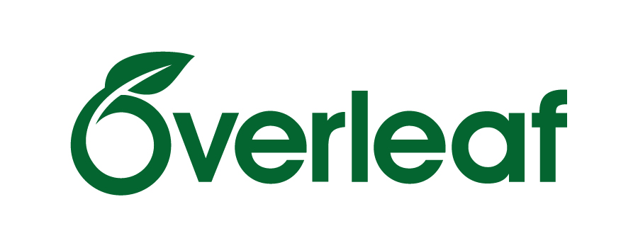

*18h00–19h45 · La BUlle (BU), campus de Pau (UPPA) · entrée libre, sans inscription*

## Objectifs

- Comprendre les avantages du balisage sémantique : pdf et papier.

## À installer avant la séance

- [$\LaTeX$](https://www.latex-project.org)
- [Typst](https://typst.app)

## Déroulé

1. Présentation de $\LaTeX$ avec Overleaf
2. les templates Pandoc
3. Typst avec Quarto

## Ressources

### $\LaTeX$

- Les [outils](https://www.face-ecran.fr/outils) de Daniel Bourrion, Conservateur des bibliothèques et écrivain (Prix Louis Barthou — Académie Française 2026 pour *Le pays dont tu as marché la terre* aux Éditions Héloïse d'Ormesson)

- [Overleaf](https://www.overleaf.com/) - édition en ligne et collaborative de document LaTeX

::: {.column-margin}
{width="70%"}
:::

- [PLMlatex](https://plmlatex.math.cnrs.fr), une instance d'*Overleaf* pour tout l'ESR français, chez *Mathrice* (CNRS)

- ἔκδοσις \[[`ekdosis`](https://www.ekdosis.org/fr/)\]\ : package $\LaTeX$ pour les éditions critiques multilingues (avec export `XML-TEI`)

### Typst

- Guide *Quarto* : [PDF with Typst](https://quarto.org/docs/output-formats/typst.html)

## Notes et retours de la séance

*À compléter après l'atelier : ce qui a été montré, questions soulevées, pratiques partagées par les participants.*
